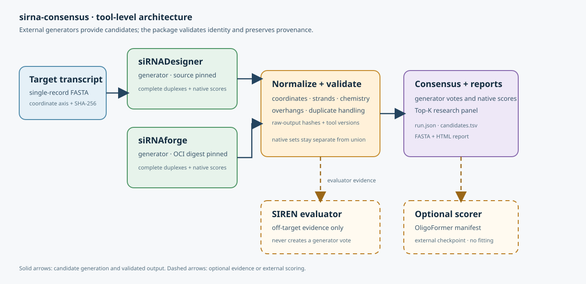

# sirna-consensus

Tool-based siRNA design that wraps registered external generators, validates their
molecular records, and produces a reproducible consensus panel. The package does not
train a ranker or ship benchmark datasets.



## Pipeline

`run` sends one transcript FASTA to the selected external tools. The default generators
are **siRNADesigner** and **siRNAforge**; **SIREN** is an optional evaluator and never
casts a generator vote. Coordinates, guide/passenger strands, overhangs, chemistry,
tool versions, native scores, and raw-output hashes are retained in `run.json`.
Malformed coordinates, inconsistent strands, missing chemistry, and fabricated overhangs
are rejected.

```bash
python -m venv .venv
.venv/bin/pip install -e '.[dev]'
sirna-consensus tools
sirna-consensus run --fasta target.fa --out native-run
sirna-consensus run --fasta target.fa --out designer-run --tools sirnadesigner
```

The default output includes `run.json`, `candidates.tsv`, `all_candidates.fa`,
`top_guides.fa`, and an HTML report. The candidate union is reported separately from
each tool's native candidate set; evaluator evidence is kept separate from generator
votes. A computational prediction does not establish experimental knockdown.

External tools run in their own environments. `siRNADesigner` is pinned by the source
SHA-256 recorded in run metadata. `siRNAforge` uses an immutable OCI image digest.
Set `SIRNA_DESIGNER_SCRIPT`, `SIRNA_CONSENSUS_PYTHON`, and `SIRNAFORGE_IMAGE` when using
local installations.

## Optional external scoring and screening

`select` can rank already generated molecules with a supplied, immutable scorer
manifest. The repository contains only the adapter; scorer checkpoints and their
training data remain outside this repository.

```bash
sirna-consensus select --fasta target.fa --run native-run/run.json \
  --scorer-manifest /path/to/oligoformer_manifest.json \
  --strategy model --out scored
```

A Bowtie reference manifest can be supplied for transcriptome specificity screening:

```bash
sirna-consensus select --fasta target.fa --run native-run/run.json --out screened \
  --screen-manifest /path/to/screen_manifest.json \
  --target-gene ENSG00000100644 --bowtie /path/to/bowtie
```

The scoring adapter performs no fitting. It records manifest and checkpoint hashes,
input conventions, and runtime provenance so a rerun can be audited.

## Validation

The package's validation tests cover parser correctness, coordinate placement, strand
orientation, duplicate handling, unavailable tools, deterministic reruns, version/hash
verification, selection, and reference screening. Run them with:

```bash
.venv/bin/pytest -q
```

The two independent efficacy benchmarks (Filhol 2012 and Wang 2009, including the
frozen OligoFormer evaluation) are maintained outside this repository under
`../independent_validation/denovo_two_benchmarks_20261105`. They are intentionally not
copied into the package and must be treated as independent external evidence. Exact
assay matches and generated-molecule coverage are reported separately; an unmeasured
molecule is never counted as inactive.

Prospective efficacy work should follow the protocol in
[docs/prospective_validation.md](docs/prospective_validation.md). Historical tool and
schema details are documented in [docs/legacy-v2.md](docs/legacy-v2.md).

## License

Package code is MIT licensed. Upstream tools, scorer checkpoints, reference data, and
experimental datasets retain their own licenses and provenance requirements.
