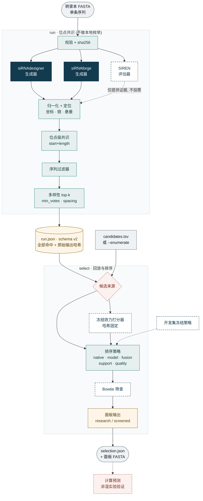
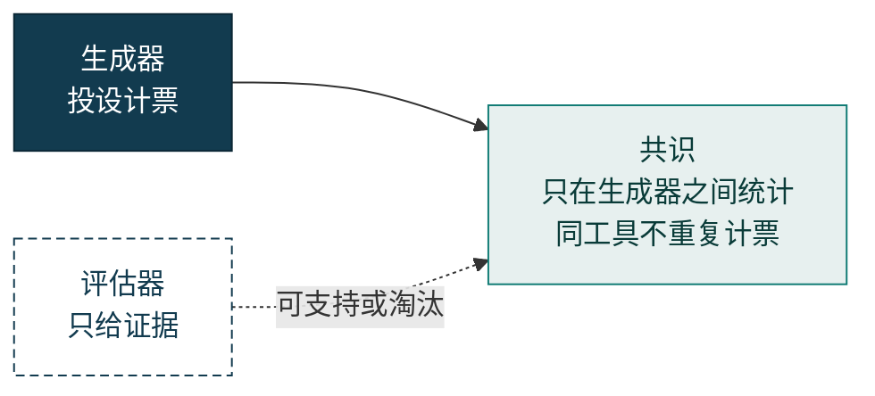
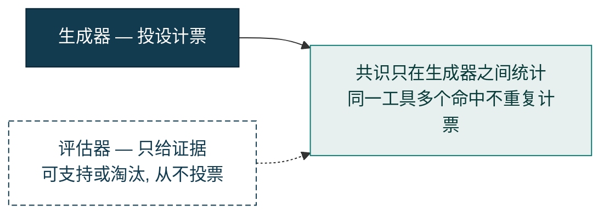

# sirna-consensus

Exact-guide siRNA selection with native design tools, an optional frozen efficacy
scorer, separate computational specificity screening, and experimental benchmarks.
Schema version 2 fixes molecular identity and benchmark semantics. It does not
establish knockdown efficacy or independent validation.

## Pipeline

The package has two commands. `run` fans a single transcript out to isolated
external tools and reduces their opinions to a site-level consensus. `select`
then replays those exact molecules (or an explicit candidate list) through
ranking, an optional frozen efficacy scorer, and an optional transcriptome
screen. Nothing is enumerated locally: the generator tools enumerate, and this
package only *places* what they return onto the transcript.









Tool roles are not interchangeable: **generators** cast design votes, **SIREN**
is an evaluator whose screen can only *support or disqualify* a generated site.
An evaluator hit is never promoted to a positive vote.

## Run and select

```bash
python -m venv .venv
.venv/bin/pip install -e '.[dev]'
sirna-consensus tools
sirna-consensus run --fasta target.fa --out native-run \
  --tools sirnadesigner,sirnaforge --min-votes 1 --site-mode exact
sirna-consensus select --fasta target.fa --run native-run/run.json \
  --out selection --strategy native --top-k 5
```

External tools run in separate environments. Set `SIRNA_DESIGNER_SCRIPT` to the
upstream script, `SIRNA_CONSENSUS_PYTHON` to its Python interpreter, and
`SIRNAFORGE_IMAGE` to the installed pinned image. The vendored siRNAdesigner script
is the fallback. Its interpreter needs NumPy and Biopython. siRNAforge needs Docker;
the default image is `ghcr.io/austin-s-h/sirnaforge:sha-4c05e4b`.

The native run captures all normalized hits and raw-output hashes. Selection
replays those hits, preserving every exact molecule instead of collapsing nearby
sites into one guide. `run` retains consensus/filter baseline options; its default
`min_votes=2` may produce an empty consensus Top-K when tools propose different
molecules. `select` does not impose that vote floor.

Outputs from `select`:

- `selection.json`: ranked candidates, format-specific panels, scores, eligibility,
  model support, screening evidence and provenance.
- `research_top.fa`: efficacy/native-ranked research guides, up to K **per format**.
- `screened_top.fa`: separately screened guides, backfilled within passing candidates.
- `diverse_top.fa`: optional 30-nt-spaced research panel.

These are research sequences. A computational screen is not biological proof of
specificity, and guide-only records do not imply a validated passenger strand.

## Molecule and score semantics

Coordinates are 1-based inclusive on the supplied transcript or experimental
construct. The binding core, original guide/passenger and documented 3′ overhangs
are separate fields. siRNAdesigner's 19-bp staggered duplex retains both original
21-nt strands. siRNAforge is explicitly run with `--modifications none --overhang
''`; unsupported chemistry from other outputs is rejected and recorded.

Molecular IDs include strand and overhang identity. Occurrence keys also include
the transcript and position. Passenger-known and passenger-unknown formats remain
separate. Invalid repeated-site coordinates are rejected rather than guessed.

SIREN remains an evaluator, not a design vote. Only exact-guide evidence can
establish its screen result; missing summaries are errors. Neighboring sites can
be shown as support but cannot donate efficacy or specificity measurements.

Selection strategies are `native`, `model`, `fusion`, `support`, `quality` and
`legacy`. Native scores are converted to within-format midrank percentiles.
`fusion` averages the model percentile and present native percentiles; `support`
uses 0.8 model + 0.2 exact-generator support; `quality` uses 0.8 model + 0.1 native
+ 0.1 sequence quality. Model absence creates a separately labeled native fallback
panel. With no native scores, `native` is explicitly a sequence-quality fallback.

Use `--filter-policy hard|soft|off` and `--disable-components tools,support,quality`
for ablations. Ties use molecular ID and position. Panels select distinct guides.

## Frozen efficacy scorer

```bash
sirna-consensus select --fasta target.fa --run native-run/run.json \
  --scorer-manifest oligoformer_manifest.json --strategy model --out model-selection
```

Apply the recorded development policy with `--policy benchmarks/results/selection_policy.json`
and its matching `--scorer-manifest`. The policy is explicitly development-only;
unsupported formats use separate fallback panels.

The optional OligoFormer worker uses local hashed checkpoints, exact positional
context, evaluation mode, batch size one and no fitting. It accepts documented
19-nt antisense binding cores; original overhangs stay attached to the candidate.
Unsupported formats are not truncated. See [benchmark instructions](benchmarks/README.md)
for runtime setup, manifests and reproducible model comparisons.

Alternatively use `select --candidates candidates.tsv` for explicit molecules or
`select --enumerate` for guide-only 19/20/21-nt transcript windows. Supplied candidate
TSVs contain `transcript_id,start,length,sense,ordered_guide,passenger,guide_overhang,
passenger_overhang`; missing strand fields mean unknown. `candidates.tsv` from a
schema-v2 native run is also supported.

## Separate sequence screen

```bash
sirna-consensus select --fasta target.fa --run native-run/run.json --out screened \
  --screen-manifest reference_manifest.json --target-gene ENSG00000109321 \
  --bowtie /path/to/bowtie
```

The reference manifest pins the FASTA, its SHA-256, transcript-to-gene mapping,
Bowtie index prefix and all six index hashes. The screen checks all binding-region
matches with up to two mismatches. Exact/one-mismatch hits in other genes exclude a
guide from the screened panel; two-mismatch and full-cDNA seed counts are advisory.
An exact intended-gene hit is required. Missing mapping, failed execution or hash
mismatch leaves candidates unverified. Same-gene isoforms are intended targets.

## Benchmarks and compatibility

See [benchmarks/README.md](benchmarks/README.md). Efficacy evaluation uses exact
measured guides and format identity, explicit assay endpoints, separate measurement
coverage, gene-weighted comparisons and source/checkpoint exposure audits.

Schema-v1 artifacts remain historical inspection material. Rerun them before
scientific evaluation: old guide strings and overlap-based metrics are not
silently migrated. `--candidate-mode legacy_site` retains a region-consensus
baseline; its cluster scores describe regions, not exact guide efficacy.

```bash
.venv/bin/python -m pytest
```

Normal tests are hermetic. External adapter tests require
`SIRNA_CONSENSUS_EXTERNAL_TESTS=1`. Package license: MIT; upstream tools, model
weights and experimental data have their own licenses.
