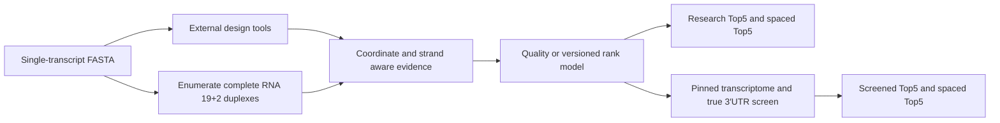

# sirna-consensus 2.0

De novo siRNA duplex design with exhaustive target-derived RNA 19+2 candidates,
separate external-tool evidence, optional learned ranking and pinned reference screening.
Default output: **Top5 with ≥30 nt between binding starts**, plus unconstrained and
screened panels. Predictions do not establish experimental knockdown.



## Design

```bash
pip install -e .
sirna-consensus run --fasta target.fa --out out/design
# Local enumeration also works without installed external tools:
sirna-consensus run --fasta target.fa --out out/research --tools ''
# Explicit frozen tool replay, for the identical transcript only:
sirna-consensus run --fasta target.fa --out out/replay --tools '' --evidence-run prior/run.json
```

Both exported strands are 21 nt RNA with a 19 bp paired core. The guide overhang is
reverse-complemented upstream target sequence; the passenger overhang is downstream
target sequence. Sites lacking two flanking bases are excluded. N-containing windows
are skipped. Other ambiguity codes are rejected. No overhang is invented.

Enumeration is not a tool vote. Tool evidence preserves coordinates and guide geometry;
a 21 bp tool binding region supports its 19 bp **sense suffix**, corresponding to the
first 19 guide bases. Full-molecule votes require matching complete strands and known
matching chemistry. Missing chemistry remains unknown. `--min-votes` defaults to zero;
setting it explicitly imposes an exact-molecule support floor. Empirical filters default
to annotations (`--filter-policy soft`); `hard` and `off` are explicit alternatives.

`run.json` schema v3 contains full candidate/evidence records, model/reference hashes,
screen failures, panel fill rates and implementation hashes. `candidates.tsv` is the
human-readable export. `top_guides.fa` is the spaced research panel, with guide and
passenger entries; `research_top.fa` is unconstrained. `screened_top.fa` and
`screened_diverse_top.fa` contain only candidates that passed the recorded screen.
A short panel is not filled with unverified candidates.

## Guarded model development

The 2026-11-06 protocol is frozen before fitting. Development and model selection use
**Huesken only**; previously evaluated, overlapping or provenance-unknown cohorts are
excluded from independent confirmation eligibility. Their original data are preserved.

```bash
pip install -e '.[ml,dev]'
sirna-consensus develop --protocol benchmarks/confirmation_20261106/protocol.json \
  --out models/huesken_only_REPLAY
python benchmarks/scripts/verify_platform_v3.py --guarded-model-dir models/huesken_only_REPLAY
python benchmarks/scripts/validate_retrospective.py all --model-dir models/huesken_only_REPLAY \
  --out benchmarks/results/confirmation_REPLAY
# Explicit development candidate only; this does not replace the default:
sirna-consensus run --fasta target.fa --out out/challenger \
  --scorer-manifest models/huesken_only_REPLAY/scorer_manifest.json
```

`train` aliases guarded `develop`; the old mixed-study training arguments are retired.
The 32 registered Ridge/tree/pairwise configurations use nested gene/sequence groups
and fold-local preprocessing. Scores represent relative rank, not knockdown probability.
The existing mixed-study default is retained as a historical development model.
**No eligible untouched confirmation cohort is currently demonstrated; no independent
performance improvement or default replacement is claimed.**

Replacement requires all registered independent NDCG, paired bootstrap, coverage,
completion, actual generated Top5 budget-yield and independent verification gates.
Missing evidence fails the gate. See [the protocol and reproduction guide](docs/guarded_confirmation.md).

## Reference screening

Download the complete transcript FASTA and matching ALL-region GTF from
[GENCODE Human release 50 / GRCh38.p14](https://www.gencodegenes.org/human/), then build
an explicitly versioned local reference with Bowtie **1.3.1**:

```bash
sirna-consensus build-reference --fasta references/gencode_v50/gencode.v50.transcripts.fa.gz \
  --gtf references/gencode_v50/gencode.v50.chr_patch_hapl_scaff.annotation.gtf.gz \
  --out references/gencode_v50/built --release GENCODE_v50_GRCh38.p14 \
  --bowtie-build /path/to/bowtie-build --hgnc references/gencode_v50/hgnc_complete_set.txt
sirna-consensus run --fasta target.fa --out out/screened \
  --screen-manifest references/gencode_v50/built/screen_manifest.json \
  --target-gene ENSG00000100644 --bowtie /path/to/bowtie
```

The reference command also supports custom species/reference pairs. Gene identifiers
must resolve uniquely; aliases and missing mappings are not guessed. The screen searches
the paired regions of **both strands**, rejects exact/one-mismatch unintended-gene sites,
and reports two-mismatch sites and both 7mer seed burdens as advisory. True spliced 3′UTRs
come from exon/CDS/stop annotations; noncoding transcripts are included in full-length
screening but have no annotated CDS-derived 3′UTR. Whole-cDNA legacy seed counts are
explicitly labeled. Missing references, corrupt indices, missing intended hits, unknown
passengers or incomplete UTR projection cannot yield a v3 screen pass.

## Validation and compatibility

```bash
pytest -m 'not external'
python benchmarks/scripts/verify_platform_v3.py --model-dir models/development_20261106
python benchmarks/scripts/evaluate_platform_v3.py --model-dir models/development_20261106 \
  --out benchmarks/results/platform_v3
python benchmarks/scripts/validate_human_screen.py \
  --manifest references/gencode_v50/built/screen_manifest.json --bowtie /path/to/bowtie \
  --out benchmarks/results/platform_v3 --model-dir models/development_20261106
python benchmarks/scripts/build_platform_report_zh.py
python benchmarks/scripts/verify_freezes.py --historical-code benchmarks/confirmation_20261106/historical_snapshots.json
```

The Chinese report is `benchmarks/three_benchmark_report_zh.html`. Measured-pool ranking
and de novo sequence coverage are separate; unknown activity is never scored as success
or failure. The prospective validation template is [docs/prospective_validation.md](docs/prospective_validation.md).

This release intentionally changes default behavior. For the previous tool-only voting
pipeline, use `run --profile legacy-v2` (default Top10, minimum two votes, historical hard
filters). `select --run old/run.json` still reads schema v2; it also reads v3 candidates.
Historical identifiers with unknown chemistry are preserved. Old commands and semantics
are documented in [docs/legacy-v2.md](docs/legacy-v2.md). Historical freeze locks remain
unchanged: their source pins are checked against immutable archived source bytes; a
separate v3 freeze checks current implementation and new results.

For exact archived-source replay: `python benchmarks/scripts/replay_legacy_source.py -- --version`
(replace `--version` with the historical CLI arguments). The historical v3 reproduction entry point, in the frozen baseline checkout, is
`bash benchmarks/scripts/reproduce_platform_v3.sh`; reference files and project-curated data
must already be present. Set `SIRNA_MODEL_PYTHON` and `SIRNA_BOWTIE` for alternative local
executable locations. The entry point also reruns two complete full-human-reference designs;
missing reference artifacts stop reproduction. Test evidence and successful human integration
are required before `python benchmarks/scripts/freeze_platform_v3.py` creates a new development
freeze. The compact tracked result is `benchmarks/platform_v3_summary.json`; large model and
reference artifacts stay local and are pinned in `benchmarks/platform_v3_freeze.json`.
Reference indexing defaults to four CPU threads; `--threads` and
`--index-bmax` are explicit resource controls. Pinned HGNC identity merges alternate loci
without guessing ambiguous aliases. Model runtime pins are in `models/.../requirements.txt`.
