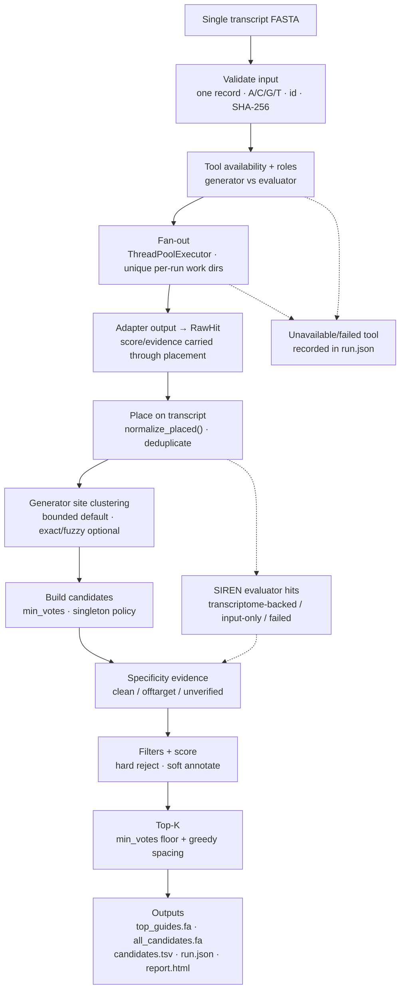

# sirna-consensus

**Release:** 1.0.0

Consensus de novo siRNA design. Give it one transcript; get back ranked candidate
guides that **several independent open-source tools agreed on**.

```
FASTA  ->  fan out to N external tools  ->  normalise onto one axis
       ->  vote at the site level       ->  your filters  ->  rank  ->  report
```

This is not another design algorithm. It wraps tools that already exist, refuses
to let any single one of them decide, and keeps the survival rules in your hands.

---

## Why consensus, and why *site* level

Exact sequence intersection between three tools is usually **empty**: they emit
different core lengths (19 vs 21), different offsets (2 nt overhang conventions),
and different strands for the *same* duplex. So agreement is defined on the site:

> two candidates agree when they sit on the same transcript, start within
> `--offset-tolerance` (default 2 nt) of each other, and share all but 2 bases.

A site's vote is the number of **distinct generator tools** that proposed it — one
verbose tool cannot outvote the others. SIREN is an **evaluator**: its 21-mer
enumeration and off-target screen are evidence, not a design vote.

Sequence filters and specificity checks are applied **after** voting. If the tools
filtered first, "use your own thresholds" would be a fiction.

## What this pipeline adds (and what it does not)

| It does | It does not |
|---|---|
| one coordinate axis for every tool's output | re-implement window enumeration |
| independent votes + explicit consensus tier | train yet another efficacy model |
| your filters, applied last | claim that agreement equals knockdown |
| full provenance (`run.json`, per-tool status) | hide a tool that failed to run |

The tools keep doing their own enumeration: they take the FASTA directly. The
only coordinate work here is *placing what comes back*.

## Detailed implementation pipeline

The executable orchestration is `src/sirna_consensus/pipeline.py`. Each stage is
a separate module, so input handling, coordinate placement, voting, filters and
reporting can be tested independently.



| stage | module | implementation detail |
|---|---|---|
| 1. Input validation | `fasta.py` | exactly one FASTA record; header's first token is the transcript id; `U`→`T`; rejects ambiguity; length 21–200,000 nt; computes SHA-256 of the sequence. |
| 2. Tool selection | `tools/__init__.py`, `tools/base.py` | registry lookup plus `availability()` without running the tool. Tools carry a role: `generator` or `evaluator`. Unusable tools are wrapped as `unavailable`; nothing is imported as a library, so each tool stays behind a subprocess boundary. |
| 3. Concurrent fan-out | `pipeline.run` | `ThreadPoolExecutor(max_workers=min(jobs, len(tools)))`; each run gets a unique `out/work/<run-id>/<tool>/` directory, so stale files from a previous run cannot be parsed. A tool exception becomes `failed` and does not abort the whole run. |
| 4. Adapter normalisation | `tools/*.py`, `types.RawHit` | each adapter decodes its own strand, overhang and alphabet conventions and returns a sense-strand DNA `RawHit`; `normalise_sequence()` converts `U`→`T`. Scores and evidence are carried into `PlacedHit`. |
| 5. Placement on one axis | `normalize.py` | `place()` trusts a reported start only if it matches the sequence; otherwise it uses a unique sequence occurrence, nearest occurrence, or rejects `ambiguous_repeat`. Deduplication key is `(tool, start, length)`; `normalize_placed()` preserves each hit's score and evidence. |
| 6. Site-level consensus | `consensus.py` | default `bounded_cluster()` anchors each cluster at its leftmost member, so shifted 19/20/21-mer predictions can join while A–B–C chains do not collapse. `--site-mode exact` uses identical `(start, length)`; `--site-mode fuzzy` is explicit single-linkage. Votes count **distinct generator tools**, not duplicate hits. |
| 7. Candidate construction | `rank.build_candidates` | applies `min_votes`; singletons remain in the inspection list but are excluded from Top-K by `diverse_top(..., min_votes=...)`; hard flags are attached; score components are recorded separately: `2·votes + 0.5·normalised_tool_score + 0.5·quality`. |
| 8. Specificity evidence | `pipeline.py`, `tools/siren.py` | SIREN is an evaluator. Its hits become evidence only: `clean` when the transcriptome-backed screen completed within `--siren-max-offtargets`; `offtarget` becomes a hard eligibility failure; `input_only`/`screen_failed` is not a transcriptome-wide claim. `--strict-specificity` requires a clean screen. |
| 9. Sequence filters | `filters.py` | configurable `FilterConfig`; hard: GC outside the configured window (default 30–55%), homopolymer ≥4, low complexity, guide 5′ end not A/U, internal palindrome. Soft: GU-rich guide, seed GC extremes, sense 3′ end. Filters run **after** voting. |
| 10. Diverse Top-K | `rank.diverse_top` | greedy selection with at least `min_spacing` (default 30 nt) between selected starts, stopping at `top_k`; `min_votes` is a hard floor. `diverse_top_balanced()` is an alternative bin-capped diversity mode. |
| 11. Provenance and reports | `report.py` | writes `candidates.tsv`, `top_guides.fa`, `all_candidates.fa`, `run.json`, `report.html`; `run.json` records `site_mode`, singleton policy, filter config, transcriptome hash, tool roles/versions and selection limits. |

Failure semantics are explicit: a failed tool is recorded, evaluator-only runs do
not create design consensus, an empty placement set raises an error, and SIREN
input-only/failed screens are never labelled transcriptome-wide.

---

## Install

```bash
python -m venv .venv && . .venv/bin/activate     # or: uv venv .venv
pip install -e ".[dev]"
sirna-consensus tools        # shows which external tools are usable
```

`sirna-consensus` itself has **no runtime dependencies**. The dependencies live
in each tool's own environment, so their pins never collide.

### Installing the external tools

Each tool runs in its own environment behind a process boundary. Put them
somewhere and point the environment at them.

**1. siRNAdesigner** — rule-based, fast, no external binaries.

```bash
git clone https://github.com/anazhmetdin/siRNAdesigner
# Pin a known checkout instead of tracking main:
git -C siRNAdesigner checkout <PINNED_COMMIT>
python -m venv tools-venv && tools-venv/bin/pip install numpy biopython
export SIRNA_DESIGNER_SCRIPT=$PWD/siRNAdesigner/siRNADesigner.py
export SIRNA_CONSENSUS_PYTHON=$PWD/tools-venv/bin/python
```

**2. SIREN** — 21-mer off-target screen via RNAhybrid.

```bash
git clone https://github.com/pablovargasmejia/SIREN
git -C SIREN checkout <PINNED_COMMIT>
tools-venv/bin/pip install ./SIREN/dist/siren_rnai-0.1.5-py3-none-any.whl
export SIREN_BIN=$PWD/tools-venv/bin/SIREN
# RNAhybrid is a C binary, not on PyPI. Without root:
mkdir -p toolbin && cd toolbin
apt-get download rnahybrid libg20
dpkg-deb -x rnahybrid_*.deb ext && dpkg-deb -x libg20_*.deb ext2
export SIRNA_CONSENSUS_TOOL_BIN=$PWD/ext/usr/bin
export SIRNA_CONSENSUS_TOOL_LIB=$PWD/ext2/usr/lib
```

**3. siRNAforge** — thermodynamics + off-target, from its pinned image.

```bash
docker pull ghcr.io/austin-s-h/sirnaforge:sha-4c05e4b
export SIRNAFORGE_IMAGE=ghcr.io/austin-s-h/sirnaforge:sha-4c05e4b
```

Run `sirna-consensus tools` until every tool you want reads `OK`.

### Expected external-tool outputs

| tool | files the adapter reads | notes |
|---|---|---|
| siRNAdesigner | `_*.csv` in the tool workdir | columns start/end/candidate/score/guide/passenger; adapter shifts start by 2 nt |
| SIREN | `other_files/sirnas.fa`, `off_targets_summary.tsv` | 21-mer records and per-siRNA off-target burden |
| siRNAforge | one CSV/TSV table from `--output` | `passenger_sequence`, `position`, `composite_score` columns |

### Environment variables

| variable | meaning |
|---|---|
| `SIRNA_CONSENSUS_PYTHON` | interpreter used for legacy tool scripts |
| `SIRNA_CONSENSUS_TOOL_BIN` | prepended to `PATH` for tool subprocesses (RNAhybrid) |
| `SIRNA_CONSENSUS_TOOL_LIB` | prepended to `LD_LIBRARY_PATH` for tool subprocesses |
| `SIRNA_CONSENSUS_TIMEOUT` | per-tool timeout in seconds (default 1800) |
| `SIRNA_CONSENSUS_TRANSCRIPTOME` | cDNA FASTA used for off-target search |
| `SIRNA_DESIGNER_SCRIPT` / `SIREN_BIN` / `SIRNAFORGE_IMAGE` | explicit tool locations |
| `SIRNAFORGE_SUBCMD` | `design` (default, fast) or `workflow` (adds off-target) |
| `SIREN_THREADS` | concurrency for SIREN's RNAhybrid stage (default `min(cpu_count, 32)`) |
| `SIREN_GENE_SELECTOR` | overrides the SIREN `-g` selector (see below) |
| `SIREN_MAX_OFFTARGETS` | max off-targets for SIREN evidence to count as clean (default 0) |
| `SIRNA_CONSENSUS_CACHE` | where the transcriptome header index is cached (default `~/.cache/sirna-consensus`) |
| `SIRNA_CONSENSUS_EXTERNAL_TESTS` | set to `1` to run the optional real-tool smoke tests |

### SIREN selectors against a non-matching transcriptome

SIREN is pointed at the reference with `-T` and at *one record inside it* with
`-g`, a substring selector matched against the record id. Our input is usually a
RefSeq accession (`NM_001657.4`) while a practical cDNA reference is Ensembl
(`ENST00000395748.8`), so passing the input id straight through matches nothing
and SIREN dies with *"Gene not found"* — before writing any off-targets.

When a transcriptome is configured the adapter therefore resolves a selector
that really occurs in it, in this order:

1. the exact transcript id,
2. the transcript id without its version suffix (only if that is unique),
3. a gene symbol / gene id — taken from `gene_symbol:`/`gene:` in the input
   header, or from the transcriptome header the input *sequence* maps to (covers
   the RefSeq-to-Ensembl case where the id carries no gene),
4. the longest token the input id shares with exactly one transcriptome id.

Membership is checked against a header index built in one streaming pass over the
FASTA (headers plus a per-record sequence digest, so sequences are never all held
in memory). It is memoised in-process and cached on disk, keyed by path, size and
mtime — a 1.4 GB cDNA file is walked once, not once per call. Set
`SIREN_GENE_SELECTOR` to skip the search entirely and pass your own `-g`.

If nothing resolves — or if SIREN still rejects the resolved selector — the run
retries against the input FASTA as a **last resort**. That keeps the run alive,
but the screen then only ever sees the input. In v1 this is recorded as
`screen_state: input_only` (or `failed`); it is **not** a design vote and **not**
transcriptome-wide specificity evidence. `detail` in `run.json` and the report
say exactly which selector was used and whether a real transcriptome-backed
screen happened:

```
screened against the transcriptome (selector 'ENST00000395748.8' (gene-symbol),
maps to ENST00000395748.8, gene ENSG00000109321.13); 495 siRNAs carry off-targets
fell back to the input FASTA only: no transcriptome selector matched
(tried 'ZZZ.1'); off-targets are input-scoped, not transcriptome-wide
```

Resolving to a *different* accession than the input is fine: reported
coordinates then refer to that transcript, and `normalize.place()` already falls
back to a sequence search when a reported start disagrees, so placement on the
input still holds when the two sequences are the same.

---

## Use

```bash
sirna-consensus run \
  --fasta NM_001657.4.fa \
  --out out/ \
  --tools sirnadesigner,siren,sirnaforge \
  --min-votes 2 --top-k 10 \
  --site-mode bounded
```

Outputs in `--out`:

| file | contents |
|---|---|
| `candidates.tsv` | every assembled candidate, with votes, score components, specificity state, flags and per-tool scores |
| `top_guides.fa` | **only the selected Top-K** order-ready guide RNA |
| `all_candidates.fa` | inspection-only FASTA for every candidate, including rejected/singleton sites with `passed=false` and flags |
| `report.html` | standalone summary: roles, screening states, effective configuration, normalisation, top table |
| `run.json` | machine-readable record: input hash, effective config, transcriptome hash, tool roles/versions/selection limits |

Python API:

```python
from sirna_consensus import Config, run

result = run(Config(
    fasta="NM_001657.4.fa",
    out_dir="out/",
    min_votes=2,
    top_k=10,
    site_mode="bounded",
    strict_specificity=False,
))
for c in result["top"]:
    print(c.consensus_tier, c.core.transcript_id, c.core.start, c.core.guide,
          c.specificity_status)
```

### Reading the output

`candidates.tsv` is 1-based and inclusive on the input transcript. `*_dna`
columns align back to the transcript; `*_rna` columns are what you order. Guides
are the reverse complement of the target window — **no stage invents a base**.

`consensus_tier` is `unanimous` or `Nof_M`, where `M` is the number of
**generator tools that actually ran**. SIREN is not in that denominator. A tool
that failed is recorded in `run.json` and reduces `M` rather than silently
vanishing.

`top_guides.fa` is the only order-ready file. `all_candidates.fa` is deliberately
separate: it includes exploratory singleton sites and filter-rejected sites so the
selection rules remain auditable.

---

## Filters

Hard (reject) — GC outside the configured window (default 30–55%), homopolymer
≥4, low sequence complexity, guide 5′ end not A/U, internal palindrome.
Soft (annotate) — GU-rich guide, seed GC extremes, sense 3′ end.

These are the published design rules, deliberately rule-based so the ranking does
not collapse into "whichever model we happened to bundle". They are configurable:

```bash
--gc-min 0.30 --gc-max 0.55 --max-homopolymer 4 \
--gu-rich-cutoff 0.75 --seed-gc-high 0.75 --seed-gc-low 0.25
```

SIREN specificity is a separate hard eligibility rule: a transcriptome-backed
screen with more than `--siren-max-offtargets` off-targets adds
`specificity_offtarget`. `--strict-specificity` rejects any candidate without a
clean screen.

## Limitations — read these before quoting a number

* **Consensus ≠ efficacy.** Generator agreement raises confidence in the site; it
  does not prove knockdown.
* **SIREN is evidence, not a design vote.** A SIREN 21-mer hit does not increase
  design consensus. An input-only or failed transcriptome screen is not
  transcriptome-wide specificity evidence, and its hits do not become clean
  evidence.
* **Top-K enforces `min_votes`.** Singleton sites remain in `candidates.tsv` and
  `all_candidates.fa` for inspection but do not enter `top_guides.fa` unless you
  set `--min-votes 1`.
* **A tool that returns only its own Top-N is indistinguishable from one that
  filtered a site out.** Widen each tool's internal `top-n` where it allows it;
  `run.json` records the adapter's selection limits.
* **Tool scores are not comparable across tools** and are only used as a
  tie-break *inside* an equal-vote group; `candidates.tsv` exposes the vote,
  normalized tool-score and quality components separately.
* **A transcriptome-wide SIREN screen is tens of CPU-hours.** RNAhybrid runs one
  process per transcript chunk, so `SIREN_THREADS` is the only knob that matters.
  SIREN falls back to input-only after a timeout/failed screen; read
  `screen_state` before treating a run as specificity-validated.
* **Off-target scope is whatever the tool was given.** Pass `--transcriptome` to
  give tools a shared reference; otherwise specificity evidence is limited.
* **Consensus shrinks the list.** Unanimous generator sites are typically single
  digits — a feature if you want 5–10 orderable duplexes, a gap if you want
  exhaustive coverage.
* **Tools that pre-filter narrow the vote.** siRNAforge applies its own GC and
  poly-run filters before emitting, so a site it dropped is indistinguishable
  from one it scored low.
* **A 3/3 tier needs three working generator tools.** SIREN does not count toward
  that denominator; with two generators, "unanimous" means 2/2.
* **The committed AREG example is a reproducibility artifact, not a benchmark.**
  It uses input-only SIREN evidence; it does not demonstrate transcriptome-wide
  specificity or experimental recovery.
* **Upstream bitrot is real.** siRNAdesigner needed a Biopython compatibility
  shim and an output flush; that shim is `tools/_shim.py` and leaves upstream
  untouched.

## Benchmarking

The `benchmarks/` directory provides an evaluation harness, not bundled wet-lab
data. `benchmarks/evaluate.py` reports recovery@K and precision@K for any run
against a benchmark TSV with `transcript_id`, `target_start`, `target_end` and
`effective` columns. Compare generator-alone runs, generator consensus, consensus
plus filters, and consensus plus ranking on held-out genes/datasets.

See `benchmarks/README.md` for the required format and commands.

## Development

```bash
pip install -e ".[dev]"
pytest -q
```

The normal test suite is hermetic: fake tools, no network, no Docker and no
external binaries. Real-adapter smoke tests are marked `external` and run only
with `SIRNA_CONSENSUS_EXTERNAL_TESTS=1`:

```bash
SIRNA_CONSENSUS_EXTERNAL_TESTS=1 pytest -q -m external
```

`sirna-consensus tools` is the integration check for a real machine.

## Licence

MIT for this package. Each wrapped tool keeps its own licence — check them
before redistribution (SIREN is GPL-3.0, siRNAforge is MIT).
