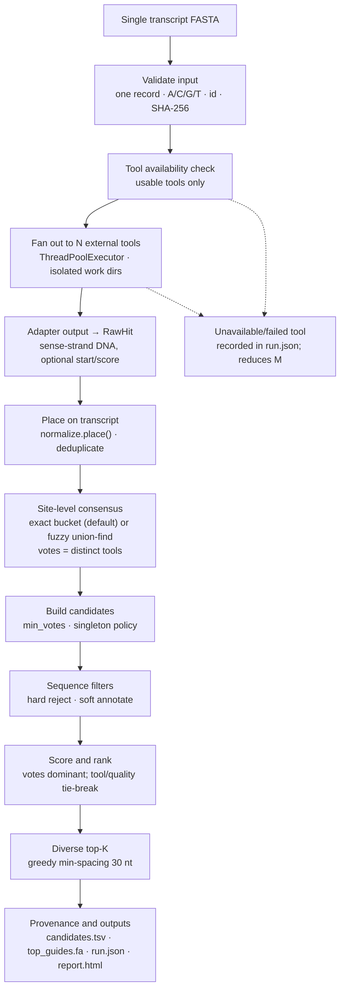

# sirna-consensus

Consensus de novo siRNA design. Give it one transcript; get back ranked candidate
guides that **several independent open-source tools agreed on**.

```
FASTA  ->  fan out to N external tools  ->  normalise onto one axis
       ->  vote at the site level       ->  your filters  ->  rank  ->  report
```

This is not another design algorithm. It wraps tools that already exist, refuses
to let any single one of them decide, and keeps the survival rules in your hands.

---

## Why consensus, and why *site* level

Exact sequence intersection between three tools is usually **empty**: they emit
different core lengths (19 vs 21), different offsets (2 nt overhang conventions),
and different strands for the *same* duplex. So agreement is defined on the site:

> two candidates agree when they sit on the same transcript, start within
> `--offset-tolerance` (default 2 nt) of each other, and share all but 2 bases.

A site's vote is the number of **distinct tools** that proposed it — one verbose
tool cannot outvote the others.

Sequence filters are applied **after** voting. If the tools filtered first, "use
your own thresholds" would be a fiction.

## What this pipeline adds (and what it does not)

| It does | It does not |
|---|---|
| one coordinate axis for every tool's output | re-implement window enumeration |
| independent votes + explicit consensus tier | train yet another efficacy model |
| your filters, applied last | claim that agreement equals knockdown |
| full provenance (`run.json`, per-tool status) | hide a tool that failed to run |

The tools keep doing their own enumeration: they take the FASTA directly. The
only coordinate work here is *placing what comes back*.

## Detailed implementation pipeline

The executable orchestration is `src/sirna_consensus/pipeline.py`. Each stage is
a separate module, so input handling, coordinate placement, voting, filters and
reporting can be tested independently.



| stage | module | implementation detail |
|---|---|---|
| 1. Input validation | `fasta.py` | exactly one FASTA record; header's first token is the transcript id; `U`→`T`; rejects ambiguity; length 21–200,000 nt; computes SHA-256 of the sequence. |
| 2. Tool selection | `tools/__init__.py`, `tools/base.py` | registry lookup plus `availability()` without running the tool. Unusable tools are wrapped as `unavailable`; nothing is imported as a library, so each tool stays behind a subprocess boundary. |
| 3. Concurrent fan-out | `pipeline.run` | `ThreadPoolExecutor(max_workers=min(jobs, len(tools)))`; each tool writes to `out/work/<tool>/`; a tool exception becomes `failed` and does not abort the whole run. |
| 4. Adapter normalisation | `tools/*.py`, `types.RawHit` | each adapter decodes its own strand, overhang and alphabet conventions and returns a sense-strand DNA `RawHit`; `normalise_sequence()` converts `U`→`T`. |
| 5. Placement on one axis | `normalize.py` | `place()` trusts a reported start only if it matches the sequence; otherwise it uses a unique sequence occurrence, nearest occurrence, or rejects `ambiguous_repeat`. Deduplication key is `(tool, start, length)`. |
| 6. Site-level consensus | `consensus.py` | default `bucket()` groups by exact `(transcript_id, start, length)` after placement. `--site-mode fuzzy` uses union-find over `offset_tolerance` + shared-base slack. Votes count **distinct tools**, not duplicate hits. The representative is the most-shared geometry (longest, then leftmost). |
| 7. Candidate construction | `rank.build_candidates` | applies `min_votes`; singletons are kept by default and tagged by tier; hard flags are attached; score = `2·votes + 0.5·normalised_tool_score + 0.5·quality`; candidates are sorted by score then start and assigned a rank. |
| 8. Sequence filters | `filters.py` | hard: GC outside 30–55%, homopolymer ≥4, low complexity, guide 5′ end not A/U, internal palindrome. Soft: GU-rich guide, seed GC extremes, sense 3′ end. Filters run **after** voting. |
| 9. Diverse top-K | `rank.diverse_top` | greedy selection with at least `min_spacing` (default 30 nt) between selected starts, stopping at `top_k`. |
| 10. Provenance and reports | `report.py` | writes `candidates.tsv`, `top_guides.fa`, `run.json`, `report.html`; counts distinguish **sites**, **candidates**, and **filter-rejected candidates**. |

Failure semantics are explicit: a failed tool is recorded and reduces the
number of acting tools `M`; an empty placement set raises an error rather than
emitting a bogus candidate; and SIREN's transcriptome fallback is described in
`run.json`/the report as input-scoped, not transcriptome-wide.

---

## Install

```bash
python -m venv .venv && . .venv/bin/activate     # or: uv venv .venv
pip install -e ".[dev]"
sirna-consensus tools        # shows which external tools are usable
```

`sirna-consensus` itself has **no runtime dependencies**. The dependencies live
in each tool's own environment, so their pins never collide.

### Installing the external tools

Each tool runs in its own environment behind a process boundary. Put them
somewhere and point the environment at them.

**1. siRNAdesigner** — rule-based, fast, no external binaries.

```bash
git clone --depth 1 https://github.com/anazhmetdin/siRNAdesigner
python -m venv tools-venv && tools-venv/bin/pip install numpy biopython
export SIRNA_DESIGNER_SCRIPT=$PWD/siRNAdesigner/siRNADesigner.py
export SIRNA_CONSENSUS_PYTHON=$PWD/tools-venv/bin/python
```

**2. SIREN** — 21-mer off-target screen via RNAhybrid.

```bash
git clone --depth 1 https://github.com/pablovargasmejia/SIREN
tools-venv/bin/pip install ./SIREN/dist/siren_rnai-0.1.5-py3-none-any.whl
export SIREN_BIN=$PWD/tools-venv/bin/SIREN
# RNAhybrid is a C binary, not on PyPI. Without root:
mkdir -p toolbin && cd toolbin
apt-get download rnahybrid libg20
dpkg-deb -x rnahybrid_*.deb ext && dpkg-deb -x libg20_*.deb ext2
export SIRNA_CONSENSUS_TOOL_BIN=$PWD/ext/usr/bin
export SIRNA_CONSENSUS_TOOL_LIB=$PWD/ext2/usr/lib
```

**3. siRNAforge** — thermodynamics + off-target, from its pinned image.

```bash
docker pull ghcr.io/austin-s-h/sirnaforge:sha-4c05e4b
export SIRNAFORGE_IMAGE=ghcr.io/austin-s-h/sirnaforge:sha-4c05e4b
```

Run `sirna-consensus tools` until every tool you want reads `OK`.

### Environment variables

| variable | meaning |
|---|---|
| `SIRNA_CONSENSUS_PYTHON` | interpreter used for legacy tool scripts |
| `SIRNA_CONSENSUS_TOOL_BIN` | prepended to `PATH` for tool subprocesses (RNAhybrid) |
| `SIRNA_CONSENSUS_TOOL_LIB` | prepended to `LD_LIBRARY_PATH` for tool subprocesses |
| `SIRNA_CONSENSUS_TIMEOUT` | per-tool timeout in seconds (default 1800) |
| `SIRNA_CONSENSUS_TRANSCRIPTOME` | cDNA FASTA used for off-target search |
| `SIRNA_DESIGNER_SCRIPT` / `SIREN_BIN` / `SIRNAFORGE_IMAGE` | explicit tool locations |
| `SIRNAFORGE_SUBCMD` | `design` (default, fast) or `workflow` (adds off-target) |
| `SIREN_THREADS` | concurrency for SIREN's RNAhybrid stage (default `min(cpu_count, 32)`) |
| `SIREN_GENE_SELECTOR` | overrides the SIREN `-g` selector (see below) |
| `SIRNA_CONSENSUS_CACHE` | where the transcriptome header index is cached (default `~/.cache/sirna-consensus`) |

### SIREN selectors against a non-matching transcriptome

SIREN is pointed at the reference with `-T` and at *one record inside it* with
`-g`, a substring selector matched against the record id. Our input is usually a
RefSeq accession (`NM_001657.4`) while a practical cDNA reference is Ensembl
(`ENST00000395748.8`), so passing the input id straight through matches nothing
and SIREN dies with *"Gene not found"* — before writing any off-targets.

When a transcriptome is configured the adapter therefore resolves a selector
that really occurs in it, in this order:

1. the exact transcript id,
2. the transcript id without its version suffix (only if that is unique),
3. a gene symbol / gene id — taken from `gene_symbol:`/`gene:` in the input
   header, or from the transcriptome header the input *sequence* maps to (covers
   the RefSeq-to-Ensembl case where the id carries no gene),
4. the longest token the input id shares with exactly one transcriptome id.

Membership is checked against a header index built in one streaming pass over the
FASTA (headers plus a per-record sequence digest, so sequences are never all held
in memory). It is memoised in-process and cached on disk, keyed by path, size and
mtime — a 1.4 GB cDNA file is walked once, not once per call. Set
`SIREN_GENE_SELECTOR` to skip the search entirely and pass your own `-g`.

If nothing resolves — or if SIREN still rejects the resolved selector — the run
retries against the input FASTA as a **last resort**. That keeps the run alive,
but the screen then only ever sees the input, so `detail` in `run.json` (and the
report) says exactly which selector was used and whether a real
transcriptome-backed screen happened:

```
screened against the transcriptome (selector 'ENST00000395748.8' (gene-symbol),
maps to ENST00000395748.8, gene ENSG00000109321.13); 495 siRNAs carry off-targets
fell back to the input FASTA only: no transcriptome selector matched
(tried 'ZZZ.1'); off-targets are input-scoped, not transcriptome-wide
```

Resolving to a *different* accession than the input is fine: reported
coordinates then refer to that transcript, and `normalize.place()` already falls
back to a sequence search when a reported start disagrees, so placement on the
input still holds when the two sequences are the same.

---

## Use

```bash
sirna-consensus run \
  --fasta NM_001657.4.fa \
  --out out/ \
  --tools sirnadesigner,siren,sirnaforge \
  --min-votes 2 --top-k 10
```

Outputs in `--out`:

| file | contents |
|---|---|
| `candidates.tsv` | every consensus site, with votes, flags and per-tool scores |
| `top_guides.fa` | order-ready guide RNA, headers carry rank / tier / site / GC |
| `report.html` | standalone summary: tool status, normalisation, top table |
| `run.json` | machine-readable record: input hash, config, per-tool outcome |

Python API:

```python
from sirna_consensus import Config, run

result = run(Config(fasta="NM_001657.4.fa", out_dir="out/", min_votes=2))
for c in result["top"]:
    print(c.votes, c.core.transcript_id, c.core.start, c.core.guide)
```

### Reading the output

`candidates.tsv` is 1-based and inclusive on the input transcript. `*_dna`
columns align back to the transcript; `*_rna` columns are what you order. Guides
are the reverse complement of the target window — **no stage invents a base**.

`consensus_tier` is `unanimous` or `N-of-M`, where M is the number of tools that
actually ran. A tool that failed is recorded in `run.json` and reduces M rather
than silently vanishing.

---

## Filters

Hard (reject) — GC outside 30–55%, homopolymer ≥4, low sequence complexity,
guide 5′ end not A/U, internal palindrome.
Soft (annotate) — GU-rich guide, seed GC extremes, sense 3′ end.

These are the published design rules, deliberately rule-based so the ranking does
not collapse into "whichever model we happened to bundle".

## Limitations — read these before quoting a number

* **Consensus ≠ efficacy.** Three tools agreeing raises confidence in the site, it
  does not prove knockdown.
* **A tool that returns only its own Top-N is indistinguishable from one that
  filtered a site out.** Widen each tool's internal `top-n` where it allows it.
* **Tool scores are not comparable across tools** and are only used as a
  tie-break *inside* an equal-vote group.
* **A transcriptome-wide SIREN screen is tens of CPU-hours.** RNAhybrid runs one
  process per transcript chunk, so `SIREN_THREADS` is the only knob that matters —
  against 224 cores the old hardcoded 8 turned a ~40 minute screen into ~5 hours.
* **Off-target scope is whatever the tool was given.** Pass
  `--transcriptome` to give them a shared reference, otherwise each tool screens
  against its own default (or nothing). SIREN in particular falls back to the
  input alone when no selector resolves inside the reference — a run whose
  `detail` says `fell back to the input FASTA only` found *zero* off-targets, not
  a clean one.
* **Consensus shrinks the list.** Unanimous sites are typically single digits — a
  feature if you want 5–10 orderable duplexes, a gap if you want exhaustive
  coverage. Singletons are kept by default and tagged by tier; drop them with
  `--exclude-singletons`.
* **Tools that pre-filter narrow the vote.** siRNAforge applies its own GC and
  poly-run filters before emitting, so a site it dropped is indistinguishable
  from one it scored low. Ask each tool for as many candidates as it allows.
* **A 3/3 tier needs at least three working tools.** With two installed,
  "unanimous" means 2/2 and carries less information.
* **Upstream bitrot is real.** siRNAdesigner needed a Biopython compatibility
  shim and an output flush; that shim is `tools/_shim.py` and leaves upstream
  untouched.

## Development

```bash
pip install -e ".[dev]"
pytest -q
```

The test suite is hermetic: it uses a fake tool, so CI needs no network, no
docker and no external binaries. `sirna-consensus tools` is the integration
check for a real machine.

## Licence

MIT for this package. Each wrapped tool keeps its own licence — check them
before redistribution (SIREN is GPL-3.0, siRNAforge is MIT).
