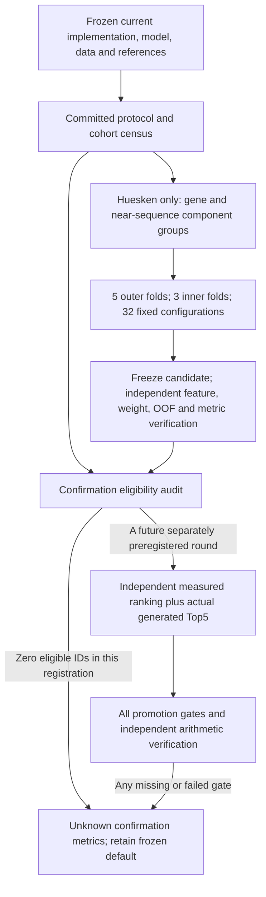

# Strict confirmation round, 2026-11-06

This round implements the architecture and evaluation protocol registered in
`benchmarks/confirmation_20261106/protocol.json` at commit `f8adbf9`, after baseline
commit `d0de4bbda81284f2dbcdbbad4dccac9cb0998d1c` and before challenger fitting.
This is local Git preregistration, without an independent timestamp. It cannot establish
that no undocumented prior exposure occurred.

## Architecture



The challenger uses either the existing 100 sequence features or 452 features including
position-specific dinucleotides and trinucleotide composition. Registered families are
weighted Ridge, shallow histogram gradient-boosting trees and pairwise logistic ranking.
There is no efficacy percentage calibration. Scalers fit within each training fold;
model choice uses only inner development folds. Sample weights give equal weight to
genes, then assays within each gene, then measurements within each assay. The pairwise
objective compares measurements only within the same assay. All fitted IDs are recorded.

Connected groups retain each canonical HGNC gene, forward/reverse-complement Hamming
≤2 19mers and shared shifted 17mers together. Candidate enumeration remains exhaustive
RNA 19+2; the standard output is Top5 with minimum 30-nt binding-start spacing. A new
ranker is available only through an explicit scorer manifest. The existing mixed-study
default is retained as a historical development model; it has **not** passed this round's
independent confirmation requirements.

## Independence and exclusions

Huesken is the only training/selection source. Sciabola was used in baseline training
and earlier adaptation. The legacy holdout and other external cohorts were already
examined; siRNAEfficacyDB also has known public training-reference sequence overlap.
Martinelli is modified and Shabalina lacks full duplex identity. The available Harborth
mapped file is empty. OligoFormer is a model manifest, not an experimental cohort.
Unknown checkpoint lineage is not evidence of independence.

The frozen census records source hashes, counts, evidence and individual reasons.
These cohorts are excluded **from independent test eligibility**, not deleted. This
round's `confirmation_ids` is empty. New data cannot be added after seeing model results;
a future round needs a new audit and preregistration before examining its outcomes.
No data are downloaded by these commands. Multi-study LOSO cannot be run while fitting
only Huesken; no external per-study evaluation is labeled LOSO.

## Endpoints and promotion gates

The primary endpoint is `macro_gene_assay_NDCG@5`: average assays within each canonical
gene, then average genes equally. Relevance uses within-assay midranks and exponential
DCG gains. NDCG requires at least five measured candidates and nonconstant activity.
Score ties use sequence, molecule ID and record ID, never activity. The measured pool
is fixed; abstentions consume ranking slots rather than removing difficult assays.

Also report precision@5, Top3 at least one active, Top5 active fraction, fixed-budget
active yield, fill, prediction/measurement coverage, abstentions and true Spearman.
Active means ≥0.7 normalized activity or ≥70% inhibition/knockdown as registered.
Precision and active fraction use the returned panel; fixed-budget yield divides by 5,
so incomplete panels are explicitly visible.

All of these are required for a default replacement:

- At least two independent studies and five independent gene/sequence components.
- NDCG@5 strictly above 0.80 and strictly positive gain over the frozen default.
- Paired gene/component bootstrap (10,000 draws, seed 20261106) 95% lower bound above zero.
- No loss of prediction coverage or completion in either spaced output panel.
- Positive **conservative lower bound** for yield gain on actual generated Top5.
- Verified provenance and independent recomputation.

Unknown activity remains unknown. Budget-yield bounds use exact complete guide,
passenger, overhangs, known chemistry and the same assay. Core/overlap identity never
transfers whole-molecule activity. The same fully specified unmeasured molecule in both
panels cancels in a paired difference; exclusive unknowns use worst-case bounds. A
measured-pool ranking gain cannot substitute for this generation gate.

## Reproduction on the existing local assets

Use an environment containing the declared `ml` dependencies. No installation or remote
fetch is performed by the workflow. On this machine `.scorer-venv/bin/python` has them.
Choose a new model/output directory on each training attempt; do not overwrite frozen
results. The original failed alias-resolution attempt is recorded separately.

```bash
export PYTHONPATH=src
SCORER_PY=.scorer-venv/bin/python
$SCORER_PY -m sirna_consensus.cli develop \
  --protocol benchmarks/confirmation_20261106/protocol.json \
  --out models/huesken_only_REPLAY
$SCORER_PY benchmarks/scripts/verify_platform_v3.py \
  --guarded-model-dir models/huesken_only_REPLAY
$SCORER_PY benchmarks/scripts/validate_retrospective.py all \
  --model-dir models/huesken_only_REPLAY \
  --out benchmarks/results/confirmation_REPLAY
$SCORER_PY benchmarks/scripts/build_platform_report_zh.py
```

The last step updates the report to the newly generated summary; the existing evidence
and original freezes remain preserved. `all` runs audit → candidate freeze → empty
prediction freeze → `evaluate.py --phase confirmation` → independent
`verify_platform_v3.py --evaluation` → decision/failure records. Individual stages are
also available. The current independent confirmation verifier is intentionally specific
to this zero-ID registration: it rejects nonempty registrations. Future confirmation
requires an independently reviewed metric/bootstrap/deployment verifier before it can
pass a promotion gate. The production evaluator alone can never promote a model.

The decision is a recorded rollback **without switching defaults**, and all independent
performance values remain null. The independent verification pass validates this blocked
outcome; it is not efficacy confirmation. Development checkpoints and OOF results are
recomputed independently using separately implemented features and metrics.

```bash
$SCORER_PY benchmarks/evaluate.py --phase confirmation \
  --protocol benchmarks/confirmation_20261106/protocol.json \
  --candidate-freeze benchmarks/results/confirmation_20261106/candidate_freeze.json \
  --predictions benchmarks/results/confirmation_20261106/predictions.json \
  --output benchmarks/results/confirmation_REPLAY_evaluation.json
python benchmarks/scripts/verify_freezes.py \
  --historical-code benchmarks/confirmation_20261106/historical_snapshots.json
python benchmarks/scripts/verify_freezes.py \
  benchmarks/confirmation_20261106/final_freeze.json
```

Old locks are unchanged; archived exact source/report bytes satisfy their original
hashes. The new round has its own final freeze. The previous four-study reproduction
script requires the baseline checkout, not the current guarded `train` command:
`git worktree add /tmp/sirna-baseline d0de4bbda81284f2dbcdbbad4dccac9cb0998d1c`.
That historical model must remain labeled development-only.
